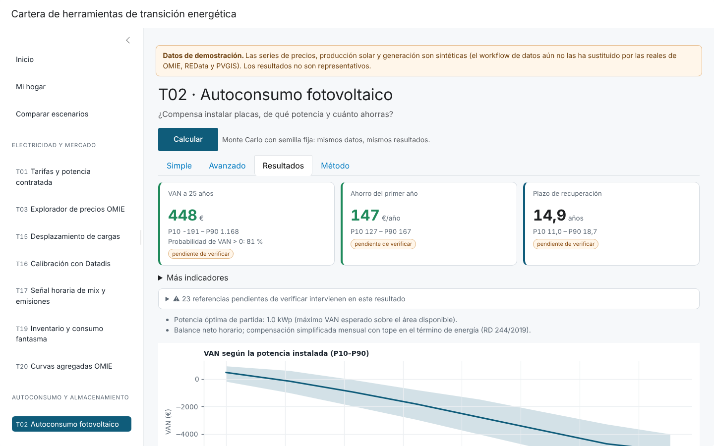

# Cartera de herramientas de transición energética

Aplicación web estática en español con **22 herramientas de decisión energética para hogares en España** (tarifas y potencia, autoconsumo fotovoltaico,
mercado diario OMIE, vehículo eléctrico, agua caliente, baterías, aerotermia, ayudas, huella de carbono, LCOE…). Construida con
[Shiny for Python](https://shiny.posit.co/py/) exportada con `shinylive`: **se ejecuta íntegramente en el navegador (Pyodide), sin servidor ni backend** y
sin ninguna llamada a terceros en tiempo de ejecución. Pensada para decisiones personales y como prueba de perfil técnico (Máster en Ingeniería de la Energía, UPM).



## Principios

- **Un perfil «Mi hogar»** (8 preguntas) compartido por todas las herramientas. Cada herramienta tiene pestañas *Simple | Avanzado | Resultados | Método*.
- **Sin datos medidos:** el modo Simple infiere parámetros técnicos como distribuciones y los contrasta con datos reales; el modo Avanzado permite sobrescribir cualquiera.
- **Incertidumbre explícita:** todas las salidas monetarias, energéticas y de emisiones son P10/P50/P90 por Monte Carlo vectorizado (N = 500 por defecto, semilla fija: mismos datos, mismos resultados).
- **Cifras trazables:** toda cifra de referencia vive en [`app/data/referencias.yaml`](app/data/referencias.yaml) con valor, unidad, fuente, URL, fecha de consulta y
  `verificado`. Las no verificadas muestran «pendiente de verificar» en la interfaz. Un test impide literales de referencia en `app/tools/` y `app/core/precios.py`.
- **Optimización** con `scipy.optimize.linprog` (HiGHS) donde hace falta (carga óptima del VE).

## Decisiones técnicas

- **Gráficos con matplotlib:** se verificó con un smoke test de `shinylive export` (gráfico mínimo renderizado en Chromium) antes de construir nada; matplotlib,
  numpy, pandas, scipy y PyYAML vienen incluidos en la distribución de Pyodide, por lo que el export los copia al sitio y no hay descargas externas.
- **MathJax local:** las ecuaciones usan `tex-svg.js` empaquetado en `app/www/mathjax/` (sin CDN).
- **Datos estáticos embebidos:** la app lee `app/data/` incluido en el propio export; el JSON de referencias evita el coste del parser YAML en el navegador.
- **Monte Carlo:** numpy vectorizado, semilla fija; el precio se remuestrea por bloques semanales de los años completos de OMIE.

## Herramientas

| Prioridad | Herramientas |
| --- | --- |
| P1 | T01 tarifas y potencia · T02 autoconsumo FV · T03 explorador OMIE · T04 VE (TCO y carga) · T05 ACS: bomba de calor vs termo/gas |
| P2 | T06 batería · T07 cargador y potencia · T08 aerotermia · T09 inducción · T10 huella de carbono · T11 ayudas · T15 desplazamiento de cargas · T16 calibración con Datadis · T17 mix y emisiones · T18 climatización de verano · T19 inventario y stand-by · T22 gas y butano |
| P3 | T12 envolvente · T13 solar térmica · T14 autoconsumo colectivo · T20 curvas agregadas OMIE · T21 explorador de LCOE |

Cada herramienta tiene su ficha de 8 secciones en [`docs/fichas/`](docs/fichas/) (el código implementa lo que dice la ficha).

## Estructura

```
app/
  app.py                 # Shiny: navegación, layout y pestañas genéricas
  core/                  # perfil, referencias, clima, perfiles de carga, precios (factura 2.0TD), finanzas, Monte Carlo, escenarios, FV, batería…
  tools/t01_tarifas.py … t22_gas.py   # cada una: preguntas() → inferir() → calcular()
  data/                  # referencias.yaml (+ .json) y datos descargados (ver app/data/README.md)
scripts/                 # fetch_data.py, generar_sintetico.py, merge_refs.py, e2e.py…
tests/                   # pytest: núcleo, una batería por herramienta y reglas de arquitectura
docs/fichas/             # T01.md … T22.md
web/herramientas.qmd     # página Quarto con la app en un iframe
.github/workflows/       # data.yml (datos diarios) y deploy.yml (shinylive → GitHub Pages)
```

## Desarrollo local

```bash
python -m venv .venv && . .venv/bin/activate
pip install -r requirements-dev.txt

python scripts/generar_sintetico.py          # solo si no tienes datos: series SINTÉTICAS de demostración
scripts/actualizar_refs.sh                   # regenera supuestos, referencias (+json) y la documentación del método
python -m pytest tests -q

shinylive export app site && python scripts/postprocesar_site.py site
python -m http.server --directory site 8008   # http://localhost:8008
python scripts/e2e.py --tools t01,t02 --ancho 375   # prueba en navegador (Playwright + Chromium)
```

## Cómo actualizar los datos

El workflow [`data.yml`](.github/workflows/data.yml) se ejecuta cada día (y a mano desde *Actions → Actualizar datos → Run workflow*):

| Fuente | Qué descarga | Destino |
| --- | --- | --- |
| OMIE `marginalpdbc` | Mercado diario ES/PT: 3 años completos + año en curso (cuartohorario promediado por hora) | `omie_es_horario.csv.gz`, `omie_percentiles.json` |
| REData (`apidatos.ree.es`) | PVPC, spot, generación por tecnología, demanda y emisiones horarias (12 meses) | `redata_horario.csv.gz` |
| PVGIS (`seriescalc`, `tmy`) | 52 capitales × 5 azimuts × 4 inclinaciones y T2m TMY (mensual o manual, con la opción *pvgis*) | `pvgis/pv_XX.npz` |
| ESIOS (opcional) | PVPC y spot, solo si existe el secreto `ESIOS_TOKEN` | `esios_horario.csv.gz` |

Local: `python scripts/fetch_data.py [--pvgis]`. Si una fuente falla se conserva la última caché y se anota en [`docs/pendientes.md`](docs/pendientes.md).
La app funciona completa sin token de ESIOS. Esquema de los ficheros: [`app/data/README.md`](app/data/README.md).

## Cómo desplegar

1. Crear el repositorio en GitHub y subir el código (`git remote add origin … && git push -u origin main`).
2. *Settings → Pages → Source: GitHub Actions*.
3. Ejecutar *Actualizar datos* (con *pvgis* la primera vez) para sustituir los datos sintéticos por los reales.
4. El workflow [`deploy.yml`](.github/workflows/deploy.yml) pasa las pruebas, exporta con `shinylive` y publica en `https://USUARIO.github.io/REPO/`.
5. Sustituir `REPO_URL` en [`app/config.py`](app/config.py) y la URL de [`web/herramientas.qmd`](web/herramientas.qmd) (iframe para la web personal con Quarto).

## Referencias pendientes de verificar

<!-- PENDIENTES:INICIO -->
Hay **410 referencias con `verificado: false`** de 419 (9 verificadas con fuente primaria). Detalle completo con notas en [`docs/referencias_pendientes.md`](docs/referencias_pendientes.md).

<details><summary>Claves pendientes por bloque</summary>

- **acs** (35): `banera_freq_dia`, `bdc_cop_nominal_acs`, `bdc_eficiencia_carnot_fraccion`, `bdc_perdidas_espera_kwh_24h`, `bdc_potencia_electrica_kw`, `bdc_tmin_aire_c`, `capex_bdc_acs_eur`, `capex_calentador_gas_eur`, `capex_termo_electrico_eur`, `caudal_alcachofa_l_min`, `condiciones_ensayo`, `demanda_referencia_l_persona_dia_60c`, `dt_ref_perdidas_k`, `duchas_persona_dia`, `duracion_ducha_min`, `horas_deposito_tipo`, `mantenimiento_anual_eur`, `otros_usos_l_persona_dia`, `perdidas_espera_termo_kwh_24h`, `rendimiento_caldera_condensacion_pcs`, `rendimiento_caldera_estandar_pcs`, `rendimiento_calentador_gas`, `rendimiento_termo_electrico`, `sg_demanda`, `t_acumulacion_bdc_c`, `t_acumulacion_c`, `t_interior_c`, `t_red_mensual_capitales`, `t_referencia_c`, `t_uso_ducha_c`, `vida_util_bdc`, `vida_util_calentador`, `vida_util_termo`, `volumen_banera_l`, `volumenes_comerciales_l`
- **almacenamiento** (12): `capacidades_candidatas_kwh`, `capacidades_comerciales_kwh`, `capex_bateria_eur_kwh`, `degradacion_anual_bateria`, `dim_fv_factor`, `dod_util`, `eficiencia_ciclo`, `n_muestras_dimensionado`, `potencia_inversor_hibrido_kw`, `reposicion_factor`, `vida_calendario_anios`, `vida_ciclos`
- **ayudas** (14): `capex_envolvente_eur`, `deduccion_irpf_ve`, `fraccion_bdc_vs_aerotermia`, `ivtm_anios`, `ivtm_bonificacion_ve`, `kwh_bateria_referencia`, `kwp_referencia`, `nextgen_aerotermia`, `nextgen_autoconsumo`, `nextgen_ve`, `prob_certificado_irpf`, `prob_convocatoria_abierta`, `prob_ordenanza`, `rehabilitacion_envolvente`
- **calefaccion** (13): `bdc_capex_aerotermia_eur`, `bdc_scop_aerotermia`, `caldera_gas_rendimiento_estacional_pcs`, `capex_caldera_condensacion_eur`, `demanda_kwh_m2_ano_por_zona`, `demanda_vs_anio_construccion`, `edad`, `factor_scop_emisores`, `fraccion_uso_calefaccion`, `mantenimiento_caldera_eur_ano`, `potencia_extra_aerotermia_kw`, `sg_demanda`, `uso`
- **cargador** (11): `confianza_horas`, `cuantil_potencia`, `desempate_eur`, `eficiencia`, `factor_simultaneidad_ve`, `monofasico_max_kw`, `p_base_noche_kw`, `p_min_gestion_kw`, `potencia_contratada_min_ve`, `potencias_kw`, `precio_wallbox_instalado_eur`
- **cocina** (12): `capex_gas_eur`, `capex_induccion_eur`, `frecuencia`, `gas_consumo_kwh_ano_persona`, `induccion_consumo_kwh_ano_persona`, `instalacion_induccion_adicional_eur`, `menaje_eur`, `potencia_extra_kw`, `rendimiento_gas_cocina`, `rendimiento_induccion`, `rendimiento_vitro`, `vida_util`
- **combustibles** (3): `inflacion_anual`, `precio_diesel_eur_l`, `precio_gasolina_95_eur_l`
- **comunidad** (15): `bonificaciones_ibi_comunidad`, `capex_fv_comunitaria_eur_wp`, `coeficientes_reparto_tipos`, `coste_gestion_anual_eur_participante`, `distancia_max_autoconsumo_colectivo_m`, `horizonte_anios`, `kwp_por_vecino`, `mezcla_ocupacion`, `n_max_mc`, `n_simulados`, `numero_tipico_vecinos`, `potencia_max_compensacion_kw`, `reparto`, `sg_consumo_vecino`, `vecinos`
- **consumo** (3): `electrico_medio_hogar`, `electrico_por_tipo_vivienda`, `reparto_usos_hogar`
- **curvas** (10): `choque_gas`, `choque_renovable`, `demanda_min_max`, `horas`, `meses`, `precio_techo`, `sd_demanda`, `sg_renovable`, `tecnologias_gas`, `tecnologias_renovables`
- **datadis** (2): `formato_csv_curva_carga`, `url_portal`
- **deducciones** (3): `ibi_fv_bonificacion`, `icio_fv_bonificacion`, `irpf_autoconsumo`
- **desplazamiento** (5): `ciclo_aparato`, `horas_habituales`, `kwh_dia_termo_defecto`, `usos_semana_termo`, `ventanas`
- **electrodomesticos** (12): `ciclo_energia_kwh`, `consumo_anual`, `consumo_standby_hogar`, `factor_edad`, `factor_standby`, `fraccion_evitable_standby`, `horas_tv`, `horas_tv_referencia`, `n_tv`, `potencia_nominal_kw`, `usos_semana_por_persona`, `ventana_programable`
- **emisiones** (21): `acv_por_tecnologia_gco2_kwh`, `butano_kgco2_kwh_pci`, `carga_desplazable_kwh_dia`, `diesel_kgco2_l`, `electricidad_peninsula_ep_no_renovable_kwh_kwh`, `electricidad_peninsula_rite_kgco2_kwh`, `estaciones`, `factor_electricidad_comercializadora_sin_garantia`, `factor_electricidad_mix_medio`, `factor_por_tecnologia_kgco2_mwh`, `fv_evitado_marginal`, `gas_conversion_pcs_pci`, `gas_natural_kgco2_kwh_pci`, `gasolina_kgco2_l`, `hibrido_reduccion_fraccion`, `mix_medio_peninsular_ultimo_anio`, `mix_residual_cnmc_ultimo_anio`, `n_muestras_correlacion`, `phev_fraccion_electrica_uso_real`, `pozo_a_rueda_diesel_kgco2_l`, `pozo_a_rueda_gasolina_kgco2_l`
- **envolvente** (19): `ahorro_tipico_fraccion`, `cop_electrica`, `coste_aislamiento_cubierta_eur_m2`, `coste_aislamiento_sate_eur_m2`, `coste_ventana_eur_m2`, `factor_ahorro_edad`, `grados_dia_calefaccion_por_zona`, `horizonte_max`, `pisos_unifamiliar`, `reduccion_infiltracion_ventana`, `reduccion_max`, `superficie_fachada_ratio`, `superficie_huecos_ratio`, `tiene_cubierta`, `tipos_edificio`, `transmitancia_u_limite_por_zona`, `u_tipica_sin_aislar`, `umbrales_ahorro`, `vida_util_aislamiento`
- **forma** (11): `acs`, `actividad_casa`, `actividad_finde`, `actividad_fuera`, `actividad_parcial`, `calefaccion`, `cocina`, `piscina`, `plana`, `refrigeracion`, `ve_casa`
- **fv** (31): `area_por_plaza_garaje_m2`, `area_tejado_por_kwp_m2`, `azimut_orientacion`, `capex_residencial_eur_wp`, `compensacion_simplificada_potencia_max_kw`, `compensacion_tope`, `degradacion_anual`, `economia_escala_exponente`, `factor_orientacion_norte`, `horas_equivalentes_espana`, `horizonte_anios`, `inclinacion_estructura_plana`, `inclinacion_muy_inclinada`, `inclinacion_tejado_teja`, `inflacion_electricidad`, `n_candidatos`, `n_muestras_dimensionado`, `opex_anual_fraccion_capex`, `paso_cuantizacion_az`, `paso_cuantizacion_incl`, `perdidas_sombreado`, `plazas_tamano`, `potencia_capex_ref_kwp`, `potencia_min_capex_kwp`, `potencia_modulo_w_m2`, `precio_excedentes_medio`, `ratio_scop_aerotermia_prevision`, `sustitucion_inversor_anio`, `sustitucion_inversor_coste_eur_kw`, `tasa_descuento_hogar`, `vida_util`
- **gas** (20): `alquiler_contador`, `banda_bombona`, `banda_variable`, `bombona_kg`, `bombonas_ano_defecto`, `butano_pcs`, `butano_precio_bombona`, `cuota_fija_evitable`, `factura_mes_eur`, `fijo_libre_ratio`, `gas_natural_impuesto_hidrocarburos`, `iva`, `oferta_libre_tipica`, `sg_butano`, `sg_precio`, `tur_termino_fijo_tur1`, `tur_termino_fijo_tur2`, `tur_termino_variable_tur1`, `tur_termino_variable_tur2`, `umbral_tur1_kwh`
- **huella** (12): `arboles_absorcion_kgco2_ano`, `factor_autobus`, `factor_avion_kgco2_pkm`, `factor_gasoleo_calefaccion_kgco2_kwh`, `factor_tren_cercanias`, `km_dia_coche`, `media_hogar_espana_tco2`, `palanca_fv_inclinacion`, `palanca_fv_kwp`, `tipo_vuelo_corto_fraccion`, `vuelos_ano`, `vuelos_tipicos_km`
- **ice** (3): `consumo_l_100km`, `coste_mantenimiento_eur_km`, `seguro_anual_eur`
- **impuestos** (3): `ibi_cuota_media`, `icio_tipo`, `ivtm_medio_eur`
- **lcoe** (16): `capex_eur_kw`, `costes_combustible_nuclear_eur_mwh`, `escenario_gas`, `factor_capacidad_espana`, `factor_emision_ccgt_t_mwh`, `factor_wacc`, `mwh_por_kw_mwh`, `opex_fijo_eur_kw_ano`, `opex_variable_eur_mwh`, `perfil_captura`, `precio_co2_eur_t`, `precio_gas_ttf_eur_mwh`, `rendimiento_ciclo_combinado`, `tecnologias`, `vida_util_anios`, `wacc`
- **mercado** (6): `costes_variables_eur_mwh`, `mecanismo_ajuste_gas_descripcion`, `omie_mtu_15min_inicio`, `omie_precio_min_max`, `precio_pvpc_descripcion`, `tecnologias_marginales_orden_merito`
- **omie** (7): `az_mi_fv`, `dias_semana`, `incl_mi_fv`, `n_spread_horas`, `tilt_mi_fv`, `umbral_precio_bajo`, `ventana_dias`
- **perfil** (19): `acs_ducha_min`, `acs_duchas_persona_dia`, `edad_vivienda_defecto`, `estacionalidad_actividad`, `exponente_personas`, `factura_mes_eur`, `fraccion_superficie_climatizada_refrig`, `meses_piscina`, `personas`, `personas_referencia`, `piscina_dias`, `piscina_horas_dia`, `sg_componente`, `sg_factura`, `sg_prior_consumo`, `superficie_m2`, `t_base_calefaccion_c`, `t_base_refrigeracion_c`, `ve_km_dia`
- **refrigeracion** (16): `capex_reversible_factor`, `capex_split_eur`, `demanda_kwh_m2_ano_por_zona`, `estancias_equipos`, `factor_reversible`, `factor_seer_real`, `factor_soleada`, `fraccion_estancias`, `potencia_electrica_eer`, `potencia_frigorifica_w_m2`, `seer_antiguo`, `seer_split`, `setpoint_c`, `sg_superficie`, `uso`, `vida_util`
- **simultaneidad** (5): `base_kw`, `dias_activos`, `dias_exceso_limitador`, `potencia_efectiva_kw`, `prob_pico_diario`
- **solar_termica** (16): `area_captador_m2`, `capex_eur_m2`, `capex_vivienda_2_captadores_eur`, `contribucion_minima_hs4_por_zona`, `eta_sistema`, `fraccion_solar_tipica`, `mantenimiento_anual_fraccion`, `n_captadores`, `pr_fv_proxy`, `rendimiento_captador`, `sg_demanda`, `t_colector_c`, `umbral_g_kw_m2`, `vida_util`, `volumen_acumulador_l_m2`, `zonas_climaticas_solares_he4`
- **tarifa** (28): `ajuste_gas_fin`, `ajuste_gas_inicio`, `ajuste_gas_tope_gas_inicial`, `alpha_corte`, `alquiler_contador`, `bono_social_descuento`, `cargo_energia_p1`, `cargo_energia_p2`, `cargo_energia_p3`, `dias_anio`, `festivos_nacionales_fijos`, `horas_periodos`, `iee_minimo_domestico`, `iee_tipo`, `indexada_margen`, `indexada_perdidas`, `indexada_servicios_ajuste`, `iva_electricidad`, `oferta_fija_energia_tipica`, `oferta_fija_potencia_tipica`, `pmax_muestras`, `potencia_sin_dato`, `potencias_normalizadas`, `pvpc_margen_comercializacion`, `ratio_periodos_fija`, `sg_f_consumo`, `sg_f_omie`, `sg_precio_nivel`
- **ve** (27): `anios_tenencia`, `ayudas_compra`, `consumo_wltp_kwh_100km`, `coste_carga_publica_eur_kwh`, `coste_mantenimiento_ve_eur_km`, `eficiencia_carga_domestica`, `f_ayuda`, `factor_consumo_real_vs_wltp`, `factor_temperatura_consumo`, `fraccion_carga_publica_por_aparcamiento`, `horarios`, `km_fin_de_semana_ano`, `km_laborable`, `km_viaje_largo`, `laborables_semana`, `penalizacion_carga_comunitaria`, `potencia_cargador_kw`, `precio_compra_diesel_eur`, `precio_compra_gasolina_eur`, `precio_compra_hibrido_eur`, `precio_compra_phev_eur`, `precio_compra_ve_eur`, `seguro_anual_eur`, `sg_precio_energia`, `valor_residual_fraccion`, `viajes_largos`, `vida_bateria_garantia`

</details>
<!-- PENDIENTES:FIN -->

## Aviso

Herramienta orientativa, no constituye asesoramiento financiero. Los resultados dependen de supuestos documentados en cada herramienta (pestaña *Método*).
